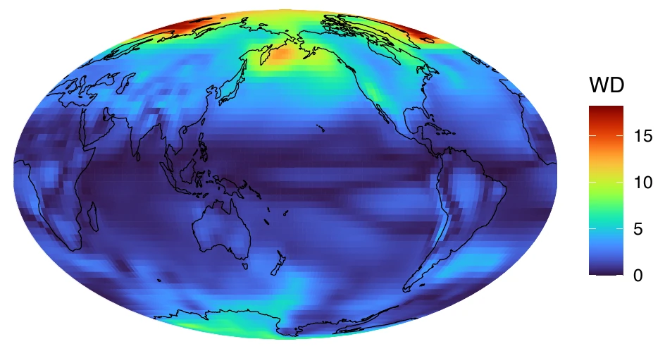
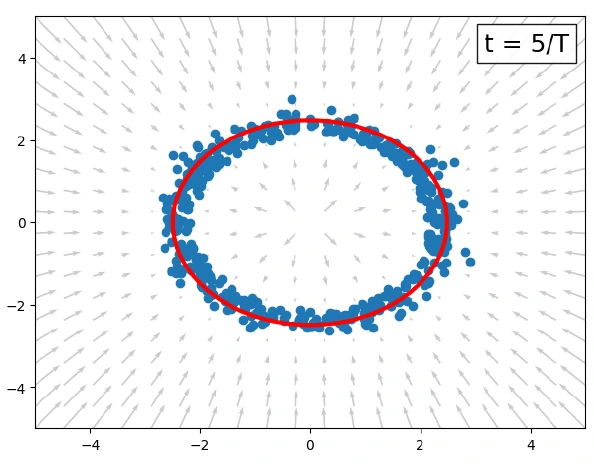
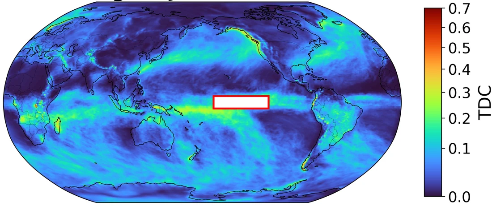

<section class="home-intro">
  <aside class="home-profile">
    
    
Assistant Professor Department of Statistics University of Connecticut <a class="profile-email" href="mailto:trevor.a.harris@uconn.edu">trevor.a.harris@uconn.edu</a>

    

      <a class="button button-primary" href="/assets/pdf/CV/Trevor_Harris_CV_Public.pdf">CV</a>
      <a class="button" href="/assets/pdf/Trevor_Harris_Resume_Public.pdf">Resume</a>
      <a class="button" href="https://github.com/trevor-harris">GitHub</a>
      <a class="button" href="https://statistics.uconn.edu/person/trevor-harris/">UConn</a>
    

  </aside>

  

    <h1>Trevor Harris</h1>
    
I am an Assistant Professor of Statistics at the University of Connecticut. I work on uncertainty quantification, statistical learning, and methods for spatial and functional data, with applications in climate science and epidemiology.

    
Much of my research asks how we can assess the reliability and uncertainty of a model's predictions and use those predictions to learn about system we're modeling. Recent works include conformal prediction for functions and spatial events, the evaluation and calibration of climate models, and uncovering latent dynamics in the climate system.

    
Before joining UConn in 2024, I was an Assistant Professor at Texas A&amp;M University. I received my PhD in Statistics from the University of Illinois Urbana-Champaign.

  

</section>

<section class="home-research" aria-labelledby="research-heading">
  <h2 id="research-heading">Research</h2>
  <section class="research-row">
    <figure class="research-figure">
      
      <figcaption><a href="https://papers.nips.cc/paper_files/paper/2024/hash/6cac74e7bb50d1f21626800f5b49a869-Abstract-Conference.html">SCWD</a> reveals where a climate model differs from reanalysis.</figcaption>
    </figure>
    

    <h3>Climate model evaluation, integration, and emulation</h3>
    
My research develops statistical methods for comparing climate simulations with observations and combining information across models and spatial resolutions. This includes optimal transport metrics for distributional bias and extremes, and operator models for estimating local climate distributions. Current work is on developing lightweight latent emulators of the climate’s forced response, with the aim of extending weather models to novel climate conditions.

    

  </section>
  <section class="research-row">
    <figure class="research-figure">
      
      <figcaption>A <a href="https://arxiv.org/abs/2602.07633">nonconformity flow</a> moves samples toward a prediction-set boundary.</figcaption>
    </figure>
    

    <h3>Uncertainty quantification and calibration</h3>
    
More broadly I also develop conformal methods for quantifying uncertainty in operators models for functions, fields, and trajectories. Recent work uses flows to represent conformal prediction sets and construct predictive distributions. I am extending this approach to calibrate probabilistic models through constrained optimal transport which find the nearest distribution that satisfies specified statistical and physical constraints.

    

  </section>
  <section class="research-row">
    <figure class="research-figure">
      
      <figcaption>Wintertime dependence between precipitation extremes and the boxed Pacific region.</figcaption>
    </figure>
    

    <h3>Dependence, extremes, and inverse problems</h3>
    
My work also studies how interactions across space and time shape environmental variability and risk. My work includes neural methods for detecting Granger-causal influences and estimating conditional dependence between precipitation extremes. In a newer direction, I am also developing simulation based inference (SBI) and confidence distributions for functional inverse problems. Applications include reconstructing unobserved climate processes from indirect observations.

    

  </section>
  
I also develop graph models for West Nile virus forecasting and optimize mosquito-control intervention policies with reinforcement learning in collaboration with epidemiologists.

</section>

<section class="home-papers" aria-labelledby="papers-heading">
  <h2 id="papers-heading">Selected papers</h2>
  <ul>
    <li><a href="https://arxiv.org/abs/2602.07633">Flow-Based Conformal Predictive Distributions</a> (2026). NeurIPS, accepted. <a class="paper-code" href="https://github.com/trevor-harris/flowcp">Code</a></li>
    <li>Decision-Focused Calibration with Adaptive Conformal Predictive Distributions (2026). ICLR, under review.</li>
    <li><a href="https://arxiv.org/abs/2607.10008">Manifold Constrained Conformal Prediction for Spatial Events</a> (2026). ICLR, under review.</li>
    <li><a href="https://arxiv.org/abs/2507.20975">Locally Adaptive Conformal Inference for Operator Models</a> (2025). Transactions on Machine Learning Research, under review. <a class="paper-code" href="https://github.com/trevor-harris/LSCI">Code</a></li>
    <li><a href="https://doi.org/10.1146/annurev-statistics-042424-022358">Statistics for Climate Science: Differentiation and Integration</a> (2026). Annual Review of Statistics and Its Application, advance online publication.</li>
    <li><a href="https://arxiv.org/abs/2408.06642">Quantifying Uncertainty in Climate Projections with Conformal Ensembles</a> (2024). Annals of Applied Statistics, accepted. <a class="paper-code" href="https://github.com/trevor-harris/confensemble">Code</a></li>
    <li><a href="https://papers.nips.cc/paper_files/paper/2024/hash/6cac74e7bb50d1f21626800f5b49a869-Abstract-Conference.html">Validating Climate Models with Spherical Convolutional Wasserstein Distance</a> (2024). NeurIPS, spotlight. <a class="paper-code" href="https://github.com/trevor-harris/SCWD">Code</a></li>
    <li><a href="https://arxiv.org/abs/2509.22657">Forecasting West Nile Virus with Deep Graph Encoders</a> (2025). arXiv preprint.</li>
  </ul>
  
See the <a href="/publications.html">full publication list</a> for all papers and their current status.

</section>

