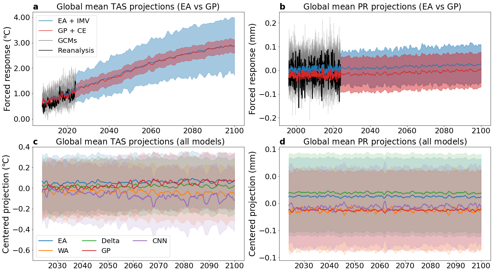
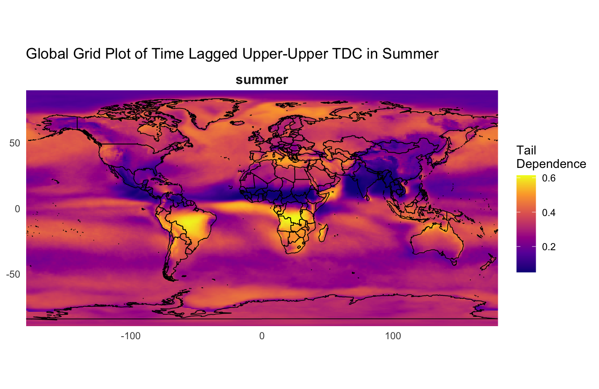

<section class="home-intro">
  <aside class="home-profile">
    
    
Assistant Professor Department of Statistics University of Connecticut <a class="profile-email" href="mailto:trevor.a.harris@uconn.edu">trevor.a.harris@uconn.edu</a>

    

      <a class="button button-primary" href="/assets/pdf/CV/Trevor_Harris_CV_Public.pdf">CV</a>
      <a class="button" href="/assets/pdf/Trevor_Harris_Resume_Public.pdf">Resume</a>
      <a class="button" href="https://github.com/trevor-harris">GitHub</a>
      <a class="button" href="https://statistics.uconn.edu/person/trevor-harris/">UConn</a>
    

  </aside>

  

    <h1>Trevor Harris</h1>
    
I am an Assistant Professor of Statistics at the University of Connecticut. I work on uncertainty quantification, statistical learning, and methods for spatial and functional data, with applications in climate science and epidemiology.

    
Much of my research asks how we can assess the uncertainty in a model's predictions and use those predictions to learn about a scientific system. Recent work studies conformal prediction for functions and spatial events, the evaluation of climate models, and forecasting from irregular monitoring networks.

    
Before joining UConn in 2024, I was an Assistant Professor at Texas A&amp;M University. I received my PhD in Statistics from the University of Illinois Urbana-Champaign.

  

</section>

<section class="home-research" aria-labelledby="research-heading">
  <h2 id="research-heading">Research</h2>
  <section>
    <h3>Climate model evaluation, integration, and emulation</h3>
    
I develop statistical methods for comparing climate simulations with observations and combining information across models and spatial resolutions. This includes optimal transport metrics for distributional bias and extremes, and operator models for estimating local climate distributions. Current work also develops lightweight emulators of the climate’s forced response, with the aim of extending weather models to unfamiliar climate conditions.

  </section>
  <section>
    <h3>Uncertainty quantification and calibration</h3>
    
I develop conformal methods for quantifying uncertainty in predictions of functions, fields, and trajectories. Recent work uses flows to represent conformal prediction sets and construct predictive distributions. I am extending this approach to calibrate probabilistic models through constrained optimal transport: finding the closest distribution that satisfies specified statistical and physical constraints.

  </section>
  <section>
    <h3>Dependence, extremes, and inverse problems</h3>
    
I study how interactions across space and time shape environmental variability and risk. My work includes neural methods for detecting Granger-causal influences and estimating conditional dependence between precipitation extremes. A newer direction develops simulation-based inference and confidence distributions for functional inverse problems, including reconstructing unobserved climate processes from indirect observations.

  </section>
  
In epidemiological collaborations, I also develop graph models for West Nile virus forecasting and study the effects of mosquito-control interventions.

</section>

  <figure class="research-figure">
    
    <figcaption>Temperature and precipitation projections from conformal ensembles and conventional ensemble methods.</figcaption>
  </figure>
  <figure class="research-figure">
    
    <figcaption>Estimated tail dependence across the globe, used to study connections between extreme events.</figcaption>
  </figure>

<section class="home-papers" aria-labelledby="papers-heading">
  <h2 id="papers-heading">Selected papers</h2>
  <ul>
    <li><a href="https://arxiv.org/abs/2602.07633">Flow-Based Conformal Predictive Distributions</a> (2026). NeurIPS, accepted. <a class="paper-code" href="https://github.com/trevor-harris/flowcp">Code</a></li>
    <li>Decision-Focused Calibration with Adaptive Conformal Predictive Distributions (2026). ICLR, under review.</li>
    <li><a href="https://arxiv.org/abs/2607.10008">Manifold Constrained Conformal Prediction for Spatial Events</a> (2026). ICLR, under review.</li>
    <li><a href="https://arxiv.org/abs/2507.20975">Locally Adaptive Conformal Inference for Operator Models</a> (2025). Transactions on Machine Learning Research, under review. <a class="paper-code" href="https://github.com/trevor-harris/LSCI">Code</a></li>
    <li><a href="https://doi.org/10.1146/annurev-statistics-042424-022358">Statistics for Climate Science: Differentiation and Integration</a> (2026). Annual Review of Statistics and Its Application, advance online publication.</li>
    <li><a href="https://arxiv.org/abs/2408.06642">Quantifying Uncertainty in Climate Projections with Conformal Ensembles</a> (2024). Annals of Applied Statistics, accepted. <a class="paper-code" href="https://github.com/trevor-harris/confensemble">Code</a></li>
    <li><a href="https://papers.nips.cc/paper_files/paper/2024/hash/6cac74e7bb50d1f21626800f5b49a869-Abstract-Conference.html">Validating Climate Models with Spherical Convolutional Wasserstein Distance</a> (2024). NeurIPS, spotlight. <a class="paper-code" href="https://github.com/trevor-harris/SCWD">Code</a></li>
    <li><a href="https://arxiv.org/abs/2509.22657">Forecasting West Nile Virus with Deep Graph Encoders</a> (2025). arXiv preprint.</li>
  </ul>
  
See the <a href="/publications.html">full publication list</a> for all papers and their current status.

</section>

